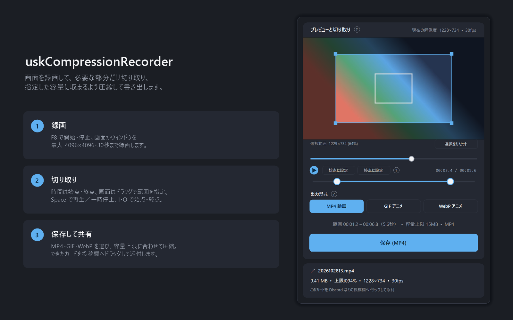
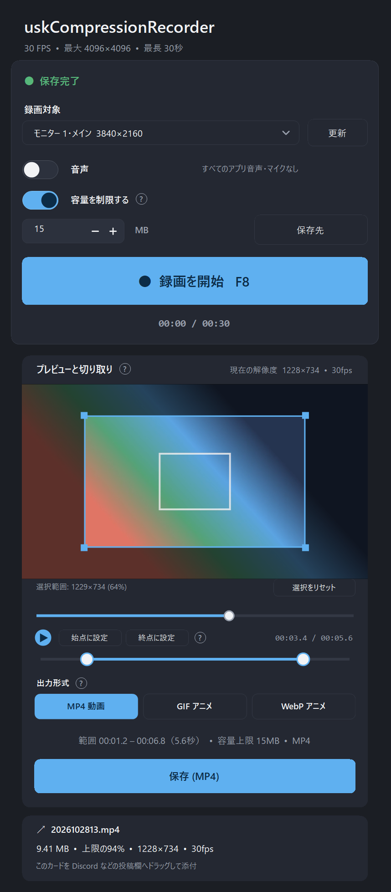

# uskCompressionRecorder



画面を録画し、必要な部分だけ切り取って、指定した容量に収まるよう圧縮して書き出す Windows 用アプリです。Discord などへすぐ共有できます。

- 画面・ウィンドウを最大 4096×4096、最長 30 秒で録画（F8 で開始／停止、音声も録れます）
- 時間と画面の範囲を切り取り。再生・一時停止、コマ送り、今の位置を始点・終点にする操作があります
- MP4／GIF／WebP（アニメ）で書き出し。容量上限（整数 MB）に収まるよう、上限ぎりぎりまで細かく圧縮
- 圧縮の優先順位: 画質（基準の約半分まで）→ 24fps → さらに画質・大きさ
- 書き出し後の解像度の予想を表示。圧縮中はクリックで中止

## 使い方

1. [Releases](../../releases) から `uskCompressionRecorder.exe` をダウンロードして起動します（**exe 1 つで動きます**。インストールや FFmpeg の用意は不要です）。
2. 「録画を開始」または F8 で録画します。
3. 切り取り・形式・容量を決めて「保存」を押し、できたファイルのカードを投稿欄へドラッグして共有します。

### 編集の操作

| 操作 | 内容 |
| --- | --- |
| 映像をドラッグ | 切り取る画面の範囲を指定（角で大きさ、内側で位置を変更） |
| 下のバーのつまみ | 切り取る時間の始点・終点を指定 |
| つまみの間をドラッグ | 長さを保ったまま範囲をずらす |
| Space | 再生／一時停止 |
| ← → | 0.1 秒ずつ移動（Shift を押しながらで 1 秒） |
| I ／ O | 今の位置を始点／終点にする（「始点に設定」「終点に設定」ボタンと同じ） |

### 保存されるファイル

保存した日付と時刻（年月日時）の名前になります。例: `2026102810.mp4`（2026 年 10 月 28 日 10 時台）。同じ時間内に 2 つ目以降を保存すると `2026102810_2.mp4` のように番号が付き、前のファイルは上書きされません。

保存先は「保存先」ボタンで変えられます（既定は `ビデオ\uskCompressionRecorder`）。設定は `%LOCALAPPDATA%\uskCompressionRecorder` に保存されます。以前の版の設定があれば、初回の起動で引き継ぎます。

Windows 10/11 x64 向けです。

## 画面



## ビルド

.NET 10 SDK が必要です。

```powershell
powershell -ExecutionPolicy Bypass -File scripts\prepare-ffmpeg.ps1   # FFmpeg を取得して埋め込み用ファイルを作る
powershell -ExecutionPolicy Bypass -File scripts\publish.ps1          # publish\uskCompressionRecorder.exe ができる
```

## ライセンス・同梱物

exe には FFmpeg（GPL v3 のビルド、改変なし）と NAudio（MIT）が含まれます。詳細は `THIRD_PARTY_NOTICES.txt`、`FFMPEG_LICENSE.txt`、`FFMPEG_SOURCE.txt` を見てください。
